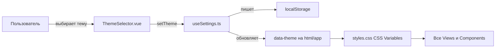

# Requirements

### Overview & Goals
Обучающий сайт для игроков ролевой игры [hp-seasons.ru](https://hp-seasons.ru/). Правила игры (как колдовать, последствия заклинаний, восприимчивость существ к разным видам магии и т.п.) подаются в виде тематических тестов с объяснениями ответов и в виде справочника правил.

Сайт реализован как **SPA на Vite + Vue 3 + TypeScript**, контент пишется в **YAML/Markdown** и при сборке превращается в **JSON**, который браузер загружает через `fetch`. Регистрации нет, прогресс и пользовательские настройки хранятся в `localStorage`.

Новое требование: добавить 3 темы визуального оформления страницы вопроса и всего сайта с возможностью **мгновенного переключения между ними в любой момент без перезагрузки страницы**:
1. **«Архив Министерства Магии» (`dossier`)**: стиль архивной папки дела под грифом, крафтово-манильский фон, штампы «ОДОБРЕНО / АННУЛИРОВАНО», машинописные акценты.
2. **«Минималистичная база знаний» (`notion`)**: ультра-чистый светлый интерфейс с современным гротеском, пастельными плашками и Notion-like блоками разбора.
3. **«Экзаменационный лист С.О.В.» (`owl`)**: академический свиток слоновой кости, сине-чёрные чернила студента и рукописные пометки красными чернилами профессора («Превосходно!» / «Ошибка»).

### Scope
#### In Scope
- Тесты по темам и общий тест по всем темам (`#/all`), выбор длины теста (20 случайных или все), режим обучения.
- Два типа вопросов: `single` (один верный, ответ в 1 клик) и `multiple` (несколько верных, с подсказкой и счётчиком).
- После ответа показывается объяснение со ссылкой на правило в справочнике и/или на первоисточник на hp-seasons.ru.
- Справочник правил: список статей и страница статьи с якорной навигацией.
- Прогресс без регистрации: сохранение лучшего и последнего результатов в `localStorage`.
- **3 темы оформления (Dossier, Notion, O.W.L.)**:
  - Переключатель темы (сегментные кнопки или выпадающий список) в шапке сайта, доступный на любой странице.
  - Мгновенное переключение тем на лету без перезагрузки страницы через реактивный `data-theme` на корневом элементе.
  - Сохранение выбранной темы в `localStorage` (`hps-settings-v1`).
- Актуализация ТЗ в `docs/SPEC.md` и документации в `README.md`.

#### Out of Scope
- Пользовательский редактор произвольных тем.
- Серверная синхронизация тем и аккаунты пользователей.
- Автоматический парсинг сайта hp-seasons.ru.

### User Stories
- Как игрок, я хочу в любой момент переключить тему оформления сайта (Архив Министерства, База знаний Notion или Экзамен С.О.В.) без перезагрузки страницы, чтобы выбрать наиболее приятный и атмосферный для себя стиль.
- Как игрок, я хочу, чтобы выбранная тема сохранялась в браузере и применялась автоматически при следующих визитах.
- Как игрок, я хочу видеть в каждой теме уникальные атмосферные детали (штампы министерства, пометки преподавателя красными чернилами или аккуратные блоки базы знаний), сохраняя при этом идеальную читаемость текста и удобство прохождения тестов.

### Functional Requirements
- **Переключатель темы**:
  - Располагается в шапке сайта (`site-header`) рядом с навигацией.
  - Показывает 3 варианта: «Архив Министерства», «База знаний», «Экзамен С.О.В.».
  - При выборе варианта тема оформления меняется мгновенно (без мерцания и без перезагрузки страницы).
  - Текущая тема сохраняется в ключе `hps-settings-v1` в свойстве `theme` (`'dossier' | 'notion' | 'owl'`). Значение по умолчанию: `'dossier'`.
- **Визуальные стили тем**:
  - **Архив Министерства (`dossier`)**: фон крафт/папка (`#E8DFD0`/`#D9CBB8`), моноширинные номера/грифы, штамп «ОДОБРЕНО» (зелёные/архивные чернила) и «АННУЛИРОВАНО» (багровые чернила), папки-вкладки.
  - **База знаний (`notion`)**: белый/светло-серый фон (`#FFFFFF`/`#F9FAFB`), строгий минимализм, пастельные плашки (`#ECFDF5`/`#FEF2F2`), аккуратные теги и иконки.
  - **Экзамен С.О.В. (`owl`)**: фон слоновой кости (`#FAF8F5`), чернила студента (`#1E293B`), рукописные пометки преподавателя красными чернилами (`#DC2626`) для вердикта и разбора.
- **Поддержка всех существующих экранов**:
  - Все страницы (Главная, Стартовый экран теста, Экран вопроса, Разбор ответа, Итоговый экран, Справочник, 404) полностью адаптируются под выбранную тему.

### Non-Functional Requirements
- Мгновенная реактивность смены темы (0 мс, чистое переключение CSS-переменных и классов через `data-theme`).
- Адаптивность для мобильных устройств во всех 3 темах.
- Высокий контраст текста и соответствие требованиям доступности (WCAG AA).

# Technical Design

### Key Decisions
- **Реактивное переключение тем без перезагрузки страницы**:
  - Атрибут `data-theme="dossier" | "notion" | "owl"` выставляется на корневом элементе (`document.documentElement` или `#app`).
  - При смене темы через `useSettings().setTheme(t)` мгновенно обновляется `document.documentElement.dataset.theme`, а также реактивный ref в приложении.
  - Сохранение в `localStorage` под ключом `hps-settings-v1` в поле `theme`. Если темы нет в хранилище, по умолчанию используется `dossier`.
- **CSS-токены и адаптация компонентов**:
  - В `src/styles.css` определяются наборы CSS-переменных (`--bg`, `--surface`, `--text`, `--muted`, `--border`, `--primary`, `--ok`, `--bad`, `--radius`, `--font-main`, `--font-heading`, `--font-accent`) для селекторов `[data-theme="dossier"]`, `[data-theme="notion"]` и `[data-theme="owl"]`.
  - Тематические декораторы компонентов:
    - **Dossier**: штампы «ОДОБРЕНО / АННУЛИРОВАНО» в `AnswerFeedback`, стилизация карточек под папки дела с ярлыками и моноширинными номерами.
    - **Notion**: аккуратные callout-блоки с мягкими пастельными плашками, лаконичные кнопки, чистый гротеск.
    - **O.W.L.**: экзаменационный бланк слоновой кости, пометки преподавателя красными чернилами («Превосходно!», «Ошибка») с рукописным/курсивным акцентом.
- **Vite + Vue 3 + TypeScript.**
- **ТЗ ведётся в `docs/SPEC.md`.** Сначала обновляется ТЗ с записью в «Историю изменений», затем код.

### Data Models / Contracts
Типы настроек (`src/composables/useSettings.ts`):
```ts
export type ThemeId = 'dossier' | 'notion' | 'owl';
export type Settings = {
  shuffleOptions: boolean;
  quizLength: QuizLength;
  theme: ThemeId;
};
```
События и методы темы:
```ts
export function useSettings(): {
  settings: Ref<Settings>;
  setShuffle(value: boolean): void;
  setQuizLength(value: QuizLength): void;
  setTheme(value: ThemeId): void;
};
```

Цветовые токены для тем:
```css
/* Dossier (Архив Министерства) */
[data-theme="dossier"] {
  --bg: #e8dfd0;
  --surface: #f4ede1;
  --text: #201e1a;
  --muted: #6b6356;
  --primary: #6b2626;
  --border: #c9bda9;
  --radius: 4px;
  --ok: #1e5a32;
  --ok-soft: #d2e8d9;
  --bad: #8e1c1c;
  --bad-soft: #f4d3d3;
  --font-main: 'PT Serif', Georgia, serif;
  --font-accent: 'Courier Prime', Courier, monospace;
}

/* Notion (База знаний) */
[data-theme="notion"] {
  --bg: #f7f7f5;
  --surface: #ffffff;
  --text: #37352f;
  --muted: #787774;
  --primary: #2383e2;
  --border: #e9e9e7;
  --radius: 8px;
  --ok: #0f7b6c;
  --ok-soft: #edf6f5;
  --bad: #eb5757;
  --bad-soft: #fdeeee;
  --font-main: system-ui, -apple-system, sans-serif;
  --font-accent: system-ui, -apple-system, sans-serif;
}

/* O.W.L. (Экзамен С.О.В.) */
[data-theme="owl"] {
  --bg: #f8f5eb;
  --surface: #fffdf7;
  --text: #1a2433;
  --muted: #5e6b7c;
  --primary: #1f3a60;
  --border: #ded8c5;
  --radius: 2px;
  --ok: #14532d;
  --ok-soft: #eaf5ee;
  --bad: #991b1b;
  --bad-soft: #fae8e8;
  --font-main: 'EB Garamond', Georgia, serif;
  --font-accent: 'Caveat', 'Marck Script', cursive, sans-serif;
}
```

### Components
- `components/ThemeSelector.vue` — селектор темы (сегментный переключатель / выпадающий список) с мгновенным `setTheme`. Размещён в `site-header` в `App.vue`.
- `App.vue` — шапка с навигацией и `ThemeSelector`.
- `components/AnswerFeedback.vue` — выводит разбор с учётом стилистики текущей темы (штамп министерства в `dossier`, пометка профессора в `owl`, callout-плашка в `notion`).
- `views/QuizView.vue`, `views/HomeView.vue`, `views/ResultView.vue`, `views/RuleView.vue` — автоматически подстраиваются под CSS-токены темы.

### Architecture Diagram


### Risks
- **Мерцание темы при первой загрузке (FOUC).** При инициализации `useSettings` сразу выставляет `data-theme` на `document.documentElement` до рендеринга представлений.
- **Совместимость со старыми записями в localStorage.** `parseSettings` безопасно подставляет тему по умолчанию (`dossier`), если поле `theme` отсутствует или невалидно.

# Testing

### Validation Approach
- Юнит-тесты Vitest для `useSettings` (чтение, сохранение, корректность fallback для старых записей и повреждённого JSON).
- Компонентные тесты Vitest + `@vue/test-utils` для `ThemeSelector.vue` и переключения `data-theme`.
- Тесты визуального вывода `AnswerFeedback.vue` и `QuizView` в различных темах.
- Проверка сборки: `vue-tsc --noEmit`, `vitest run`, `npm run build`.

### Key Scenarios
- Переключение темы в `ThemeSelector` сразу меняет атрибут `data-theme` на корневом элементе и сохраняет значение в `localStorage`.
- При перезагрузке страницы сохранённая тема восстанавливается без сброса.
- Страницы вопроса, разбора и итогов отображают корректные классы/элементы для тем `dossier`, `notion`, `owl`.
- `docs/SPEC.md` содержит актуальные требования к темам и историю изменений.

# Delivery Steps

### ✓ Step 1: Файл ТЗ, каркас проекта и конвейер контента YAML/MD → JSON
Создано ТЗ `docs/SPEC.md`, проект на Vite + Vue 3 + TS и конвейер `build-content.ts`.

### ✓ Step 2: Загрузка данных, роутинг и справочник правил
Реализован роутер, справочник правил с якорной навигацией и карточки тем на главной.

### ✓ Step 3: Движок тестов: вопросы, проверка, объяснения, итог
Реализованы типы вопросов, быстрый клик в single, подсказки, перемешивание вариантов и разбор ответов.

### ✓ Step 4: Прогресс в localStorage, документация и сверка ТЗ
Реализован прогресс, очистка, документация в README.md и проверка сборки.

### ✓ Step 5: Режимы теста: 20 случайных / все, режим обучения, тест по всем темам
Удалён свободный ввод, добавлен стартовый экран выбора длины теста, режим обучения и тест по всем темам (`#/all`).

### ✓ Step 6: Обновление ТЗ (docs/SPEC.md), модели настроек useSettings и компонента ThemeSelector
В ТЗ зафиксированы 3 темы оформления с переключением на лету; в `useSettings` добавлена поддержка `theme` (`dossier`, `notion`, `owl`), в шапку добавлен компонент `ThemeSelector`.

- Обновить `docs/SPEC.md` (раздел тем, функциональные требования, история изменений).
- Расширить `src/composables/useSettings.ts`: добавить `ThemeId`, поле `theme` в `Settings`, метод `setTheme(theme)`, автоматическую синхронизацию с `document.documentElement.dataset.theme`.
- Создать компонент `src/components/ThemeSelector.vue` и встроить его в `src/App.vue`.
- Написать юнит-тесты на сохранение темы и компонентные тесты селектора в `tests/settings.test.ts`.

### ✓ Step 7: Стилизация 3 тем в CSS, оформление разбора ответов и проверка работы
В `styles.css` и компонентах разбора реализованы уникальные стили для тем «Архив Министерства», «База знаний Notion» и «Экзамен С.О.В.», проект собирается и верифицируется.

- Описать CSS-переменные и уникальные стилевые правила для `[data-theme="dossier"]`, `[data-theme="notion"]` и `[data-theme="owl"]` в `src/styles.css`.
- Оформить карточки вопросов, кнопки, шапку и разбор `AnswerFeedback.vue` (штампы «ОДОБРЕНО / АННУЛИРОВАНО» для досье, рукописный вердикт для С.О.В., callout-блок для Notion).
- Обновить документацию в `README.md`.
- Запустить `npx vue-tsc --noEmit`, `npx vitest run`, `npm run build` и подготовить ссылку для проверки.