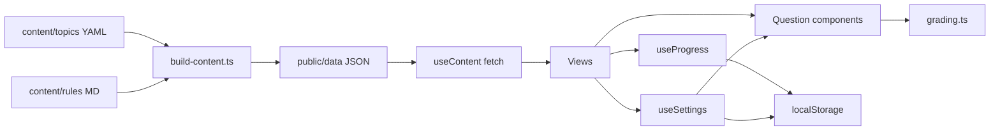

# Requirements

### Overview & Goals
Обучающий сайт для игроков ролевой игры [hp-seasons.ru](https://hp-seasons.ru/). Правила игры (как колдовать, последствия заклинаний, восприимчивость существ к разным видам магии и т.п.) подаются в виде тематических тестов с объяснениями ответов и в виде справочника правил.

Проект пока пустой (в репозитории только `LICENSE`). Вы не выбрали архитектуру, поэтому план основан на допущениях: **SPA на Vite + Vue 3 + TypeScript**, контент пишется в **YAML/Markdown** и при сборке превращается в **JSON**, который браузер загружает через `fetch`. Регистрации нет, прогресс хранится в `localStorage`.

### Scope
#### In Scope
- Тесты, разбитые по темам (заклинания, последствия, существа и т.д.).
- Три типа вопросов: один верный ответ, несколько верных, ввод текста (например, формулы заклинания).
- После ответа показывается объяснение со ссылкой на правило в справочнике и/или на первоисточник на hp-seasons.ru.
- Справочник правил: список статей и страница статьи.
- Прогресс без регистрации: лучший результат и последняя попытка по каждой теме сохраняются в `localStorage`.
- Контент лежит в git: YAML с тестами и Markdown с правилами. Скрипт проверяет схему и генерирует JSON.
- Демонстрационный контент: 2–3 темы с несколькими вопросами и 2–3 статьи правил. Реальный контент пишут авторы.
- Переключатель «Перемешивать варианты ответов» (вкл/выкл), сохраняется в `localStorage`.
- Отдельный файл ТЗ `docs/SPEC.md`: полное самодостаточное техническое задание, по которому сайт можно заново сгенерировать любой другой моделью. Файл обновляется при каждом изменении или дополнении требований.

#### Out of Scope
- Регистрация, серверная проверка ответов, админка.
- Автоматический парсинг сайта hp-seasons.ru.
- Случайный экзамен с таймером и вопросы на сопоставление (возможное развитие).
- Настройка CI/деплоя. Итог работы: статическая сборка `dist/`, которую можно выложить на GitHub Pages, Netlify и т.п.

### User Stories
- Как игрок, я хочу выбрать тему и пройти по ней тест, чтобы проверить, как знаю правила.
- Как игрок, я хочу после каждого ответа видеть, верен ли он, и объяснение со ссылкой на правило, чтобы разобраться в ошибках.
- Как игрок, я хочу открыть справочник и прочитать правило целиком.
- Как игрок, я хочу видеть свой лучший результат по каждой теме и после перезагрузки страницы.
- Как автор контента, я хочу добавлять вопросы в YAML-файл и сразу узнавать об ошибках в нём при сборке.
- Как игрок, я хочу отвечать на вопрос с одним верным вариантом одним кликом, чтобы проходить тест быстрее.
- Как игрок, я хочу видеть, сколько вариантов нужно выбрать, чтобы не гадать, один верный ответ или несколько.
- Как игрок, я хочу выбирать, перемешивать ли варианты ответов, чтобы тренироваться либо в привычном порядке, либо без привязки к позиции.
- Как владелец проекта, я хочу иметь актуальное ТЗ в отдельном файле, чтобы перегенерировать сайт на другой модели.

### Functional Requirements
- **Главная** показывает список тем: название, описание, число вопросов и лучший результат из `localStorage`.
- **Тест**:
  - вопросы идут по одному в порядке из файла темы;
  - **порядок вариантов** зависит от переключателя «Перемешивать варианты ответов» (по умолчанию включён). Переключатель есть на главной и на экране теста, значение хранится в `localStorage` (`hps-settings-v1`). Если перемешивание включено, порядок выбирается один раз при показе вопроса и не меняется до конца попытки (в том числе при показе разбора). Если выключено, варианты идут в порядке из YAML. Изменение настройки во время теста применяется со следующего вопроса;
  - **над вариантами показывается подсказка** о числе вариантов, которые нужно выбрать: для `single` «Выберите 1 вариант»; для `multiple` «Выберите N вариант/варианта/вариантов» (N — число верных вариантов, слово склоняется по-русски: 2 варианта, 5 вариантов); для `text` «Введите ответ»;
  - **`single` отвечается одним кликом**: каждый вариант — крупная кнопка, нажатие сразу фиксирует ответ и показывает разбор. Кнопки «Ответить» нет. После ответа варианты блокируются;
  - **`multiple`**: варианты — переключаемые кнопки или чекбоксы, рядом счётчик «Выбрано X из N». Кнопка «Ответить» активна, только когда выбрано ровно N вариантов;
  - **`text`**: поле ввода и кнопка «Ответить», которая активна только для непустого ответа. Ответ можно отправить клавишей Enter;
  - после ответа показывается «верно/неверно», правильный ответ, текст `explanation` и ссылки на правило и источник;
  - затем кнопка «Далее».
- **Проверка ответов**:
  - `single`: выбранный вариант совпадает с верным;
  - `multiple`: выбранное множество в точности совпадает с верным множеством (частичного зачёта нет);
  - `text`: ответ сравнивается с каждым из допустимых `answers` без учёта регистра, лишних пробелов, `ё/е` и конечной пунктуации.
- **Результат**: счёт `X из N`, процент, список ошибок со ссылками на правила, кнопки «Пройти заново» и «К темам».
- **Справочник**: список статей, сгруппированных по разделам, и страница статьи (Markdown, заранее превращённый в HTML) с якорями на подзаголовки. Ссылка `rule: spells#unforgivable` из вопроса ведёт к нужному якорю.
- Если темы или правила нет, показывается страница «Не найдено». Если JSON не загрузился, показывается сообщение об ошибке и кнопка «Повторить».
- Сборка падает с понятным сообщением (файл и путь до поля), если в контенте ошибка схемы, дублируется `id`, у `single` не ровно один верный вариант или вопрос ссылается на несуществующее правило.

### Non-Functional Requirements
- Сайт полностью статический и работает на любом статическом хостинге. Используется hash-роутинг, чтобы хостингу не требовалась настройка.
- Адаптивная вёрстка для мобильных: многие игроки сидят с телефона.
- Интерфейс на русском языке.
- Данные по каждой теме лежат в отдельном JSON и загружаются только при открытии этой темы.

# Technical Design

### Key Decisions
- **Vite + Vue 3 + TypeScript.** Это лучший баланс простоты и масштабируемости из рассмотренных вариантов (vanilla JS, Astro, Node API). Каждый тип вопроса оформляется отдельным компонентом. Сборка даёт чистую статику.
- **Контент пишется в YAML/Markdown, на сайт отдаётся JSON.** YAML удобно писать руками и в нём можно оставлять комментарии. Node-скрипт `scripts/build-content.ts` проверяет схему через `zod`, рендерит Markdown через `markdown-it` и кладёт JSON в `public/data/`. Скрипт запускается перед `vite dev` и `vite build`.
- **Ответы проверяются в браузере.** Верные ответы видны в JSON, для учебного сайта это допустимо. Проверка вынесена в чистые функции, их легко тестировать.
- **Без Pinia.** Хватит composables (`useContent`, `useProgress`) и `localStorage`.
- **Vue Router в режиме `createWebHashHistory`**, чтобы сайт работал на GitHub Pages без настройки.
- **Vitest + @vue/test-utils** для тестов.
- **Перемешивание только в отображении.** `shuffle` переставляет копию массива `options` при монтировании вопроса. Проверка работает по `id` вариантов, поэтому от порядка не зависит.
- **Число N для подсказки берётся из данных:** `options.filter(o => o.correct).length`. Отдельное поле в YAML не нужно.
- **ТЗ ведётся в `docs/SPEC.md`,** а не только в этом плане. Правило «при изменении требований сначала обновить `docs/SPEC.md`» записывается в `AGENTS.md` в корне репозитория и в README.

### Data Models / Contracts
Исходный YAML темы (`content/topics/spells.yaml`):
```yaml
id: spells
title: Заклинания
description: Формулы, жесты и условия колдовства
order: 1
questions:
  - id: q1
    type: single            # single | multiple | text
    prompt: Что произойдёт, если...
    options:
      - { id: a, text: ..., correct: true }
      - { id: b, text: ... }
    explanation: Согласно правилу...
    rule: spells#casting      # ссылка на статью справочника и якорь
    source: https://hp-seasons.ru/...   # необязательно
  - id: q2
    type: text
    prompt: Напишите формулу Обезоруживающего заклятия
    answers: [Экспеллиармус, Expelliarmus]
    explanation: ...
```
Статья правила (`content/rules/spells.md`) состоит из frontmatter (`id`, `title`, `section`, `order`) и Markdown-текста.

Типы, общие для скрипта и приложения (`src/types/content.ts`):
```ts
type QuestionBase = { id: string; prompt: string; explanation: string; rule?: string; source?: string };
type Option = { id: string; text: string; correct?: boolean };
type SingleQuestion = QuestionBase & { type: 'single'; options: Option[] };
type MultipleQuestion = QuestionBase & { type: 'multiple'; options: Option[] };
type TextQuestion = QuestionBase & { type: 'text'; answers: string[] };
type Question = SingleQuestion | MultipleQuestion | TextQuestion;
type TopicSummary = { id: string; title: string; description: string; order: number; questionCount: number };
type Topic = TopicSummary & { questions: Question[] };
type RuleSummary = { id: string; title: string; section: string; order: number; anchors: { id: string; title: string }[] };
type Rule = RuleSummary & { html: string };
type UserAnswer = { kind: 'single'; optionId: string } | { kind: 'multiple'; optionIds: string[] } | { kind: 'text'; value: string };
```
Сгенерированные файлы: `public/data/topics.json` (`TopicSummary[]`), `public/data/topics/<id>.json` (`Topic`), `public/data/rules.json` (`RuleSummary[]`), `public/data/rules/<id>.json` (`Rule`).

Проверка ответов (`src/domain/grading.ts`):
```ts
export function normalizeText(s: string): string;   // lower, trim, схлопывание пробелов, ё→е, без конечной пунктуации
export function isCorrect(q: Question, a: UserAnswer): boolean;
```
Прогресс (`src/composables/useProgress.ts`), ключ `localStorage` `hps-progress-v1`:
```ts
type TopicProgress = { best: number; last: number; total: number; updatedAt: string };
useProgress(): { get(topicId): TopicProgress | undefined; record(topicId, score, total): void; reset(): void }
```
Настройки (`src/composables/useSettings.ts`), ключ `localStorage` `hps-settings-v1`:
```ts
type Settings = { shuffleOptions: boolean };   // по умолчанию true
useSettings(): { settings: Ref<Settings>; setShuffle(v: boolean): void }
```
Подсказка о выборе (`src/domain/hints.ts`):
```ts
export function correctCount(q: SingleQuestion | MultipleQuestion): number;
export function pluralRu(n: number, forms: [string, string, string]): string; // вариант/варианта/вариантов
export function selectionHint(q: Question): string; // «Выберите 1 вариант», «Выберите 3 варианта», «Введите ответ»
```

### Components
- `views/HomeView.vue`: список тем с прогрессом.
- `views/QuizView.vue`: состояние прохождения (индекс вопроса, ответы, показан ли разбор).
- `views/ResultView.vue`: итоговый экран, отрисовывается внутри `QuizView` по окончании теста.
- `views/RulesIndexView.vue`, `views/RuleView.vue`: справочник.
- `components/questions/SingleChoice.vue`: варианты в виде кнопок, событие `answer` по клику (ответ сразу отправляется).
- `components/questions/MultipleChoice.vue`: переключаемые варианты, счётчик «Выбрано X из N», кнопка «Ответить» активна при X = N.
- `components/questions/TextAnswer.vue`: поле ввода, кнопка «Ответить», отправка по Enter.
- `components/questions/QuestionRenderer.vue`: выбирает компонент по `type`, выводит `selectionHint`, применяет перемешивание по `useSettings`. Наружу отдаёт единое событие `answer(UserAnswer)`.
- `components/ShuffleToggle.vue`: переключатель «Перемешивать варианты ответов», используется в `HomeView` и `QuizView`.
- `components/AnswerFeedback.vue`: верно/неверно, правильный ответ, объяснение, ссылки на правило и источник.
- `composables/useContent.ts`: `fetch` к `import.meta.env.BASE_URL + 'data/...'` с кэшем в памяти и состояниями `loading/error/data`.

### File Structure
```
package.json, vite.config.ts, tsconfig.json, index.html, README.md
AGENTS.md                  # правило: изменения требований сначала вносятся в docs/SPEC.md
docs/
  SPEC.md                  # самодостаточное ТЗ для перегенерации сайта
content/
  topics/*.yaml            # тесты (демо: spells, consequences, creatures)
  rules/*.md               # справочник
scripts/
  build-content.ts         # YAML/MD -> public/data/*.json + валидация
  schema.ts                # zod-схемы
public/data/               # генерируется, в .gitignore
src/
  main.ts, App.vue, router.ts, styles.css
  types/content.ts
  domain/grading.ts, domain/shuffle.ts, domain/hints.ts
  composables/useContent.ts, useProgress.ts, useSettings.ts
  views/*.vue
  components/AnswerFeedback.vue, components/ShuffleToggle.vue, components/questions/*.vue
tests/                     # *.test.ts (Vitest)
```

### Architecture Diagram


### Risks
- **Ответы видны в JSON.** Это сознательный компромисс. Если понадобится скрыть ответы, можно перейти на Node API, не меняя схему контента.
- **Текстовые ответы ошибочно засчитываются как неверные.** Нормализация и несколько допустимых `answers` снижают риск.
- **Ссылки из вопросов на правила ломаются.** Скрипт сборки проверяет, что статья и якорь в `rule` существуют.
- **Пути на GitHub Pages.** Все `fetch` строятся от `import.meta.env.BASE_URL`, `base` задаётся в `vite.config.ts`.
- **Случайный клик в `single` сразу засчитывается.** Это осознанное решение ради скорости. Кнопки делаются крупными, с отступами между ними, чтобы на телефоне промахиваться реже.
- **ТЗ расходится с кодом.** Правило в `AGENTS.md` и README, а также финальная сверка `docs/SPEC.md` с реализацией.

# Testing

### Validation Approach
Юнит-тесты Vitest для логики и скрипта контента, компонентные тесты через `@vue/test-utils`. Для каждой стадии дополнительно выполняются `npm run build` и `vue-tsc --noEmit`.

### Key Scenarios
- `isCorrect` для `single`, `multiple` (точное совпадение множеств) и `text` (нормализация: регистр, пробелы, `ё/е`, конечная точка).
- `build-content` на демо-контенте генерирует `topics.json`, `topics/<id>.json`, `rules.json`, `rules/<id>.json` с ожидаемыми полями и `questionCount`.
- `QuizView`: ответ, затем разбор, затем «Далее», в конце итог. Счёт считается верно.
- `useProgress.record` сохраняет `best` как максимум из попыток, данные читаются после повторной инициализации.
- `RuleView` выводит HTML статьи и якоря.
- `SingleChoice`: один клик по варианту сразу генерирует `answer`, показывается разбор, варианты заблокированы. Кнопки «Ответить» нет.
- `MultipleChoice`: при N = 2 видна подсказка «Выберите 2 варианта». «Ответить» неактивна при 1 и 3 выбранных и активна при 2.
- `selectionHint`/`pluralRu`: 1 вариант, 2–4 варианта, 5 вариантов, 11 вариантов, 21 вариант, 22 варианта.
- Переключатель перемешивания: если он выключен, порядок вариантов совпадает с YAML; если включён, `shuffle` вызывается (в тесте подменяется). Настройка сохраняется после перезагрузки.
- `docs/SPEC.md` описывает все функции, которые реализованы (сверка вручную в финальной стадии).

### Edge Cases
- Невалидный YAML: нет `explanation`, у `single` два верных варианта, дубли `id`, `rule` ссылается на несуществующую статью. Сборка падает с указанием файла и поля.
- Повреждённый JSON в `localStorage`: прогресс сбрасывается без падения приложения.
- Несуществующая тема в URL: страница «Не найдено». Ошибка `fetch`: сообщение и кнопка «Повторить».
- Пустой ответ (`text`) или неверное число выбранных вариантов (`multiple`): кнопка «Ответить» неактивна.
- Порядок вариантов не меняется между ответом и показом разбора.
- Повреждённый `hps-settings-v1`: используются значения по умолчанию.

# Delivery Steps

### ✓ Step 1: Файл ТЗ, каркас проекта и конвейер контента YAML/MD → JSON
В репозитории есть самодостаточное ТЗ `docs/SPEC.md`, проект на Vite + Vue 3 + TS запускается, а `npm run content` превращает демо-контент в проверенные JSON-файлы.

- Создать `docs/SPEC.md` — полное ТЗ, понятное без этого плана:
  - цель и аудитория;
  - объём работ (в рамках и вне рамок);
  - пользовательские истории;
  - все функциональные требования, включая клик по варианту в `single`, подсказку «Выберите N вариантов» и переключатель перемешивания;
  - нефункциональные требования;
  - стек и ключевые решения;
  - форматы контента (YAML/MD) и генерируемого JSON с примерами;
  - правила проверки ответов;
  - структура файлов;
  - критерии приёмки;
  - раздел «История изменений».
- Создать `AGENTS.md` с правилом: любое изменение или дополнение требований сначала вносится в `docs/SPEC.md` (с записью в «Историю изменений»), потом в код.

- Инициализировать `package.json`, `vite.config.ts` (с `base`), `tsconfig.json`, `index.html`, `.gitignore` (в нём `public/data/`), зависимости: vue, vue-router, js-yaml, gray-matter, markdown-it, zod, vitest, @vue/test-utils, tsx.
- Описать типы в `src/types/content.ts` и zod-схемы в `scripts/schema.ts`.
- Написать `scripts/build-content.ts`:
  - чтение `content/topics/*.yaml` и `content/rules/*.md`;
  - валидация, проверка уникальности `id` и ссылок `rule`;
  - рендер Markdown с якорями;
  - запись `public/data/*.json`.
- Подключить скрипт в `predev`/`prebuild`.
- Добавить демо-контент: 3 темы (заклинания, последствия, существа) и 2–3 статьи правил.
- Написать тесты скрипта на валидный и невалидный контент.

### ✓ Step 2: Загрузка данных, роутинг и справочник правил
Приложение показывает список тем на главной и полноценно работающий справочник правил.

- Создать `src/router.ts` с hash-историей и маршрутами `/`, `/topic/:id`, `/rules`, `/rules/:id`, а также страницу «Не найдено».
- Написать `useContent.ts`: `fetch` от `BASE_URL`, кэш в памяти, состояния загрузки и ошибки, кнопка «Повторить».
- `App.vue` с навигацией, базовые адаптивные стили в `styles.css`.
- `HomeView.vue`: карточки тем.
- `RulesIndexView.vue`: статьи, сгруппированные по разделам.
- `RuleView.vue`: HTML статьи, переход к якорю.
- Написать компонентные тесты для справочника и обработки ошибок.

### ✓ Step 3: Движок тестов: вопросы, проверка, объяснения, итог
Тему можно пройти целиком: на каждый ответ показываются разбор и ссылка на правило, в конце итоговый экран.

- Создать `src/domain/grading.ts` (`normalizeText`, `isCorrect`), `src/domain/shuffle.ts` и `src/domain/hints.ts` (`correctCount`, `pluralRu`, `selectionHint`).
- `SingleChoice.vue`: ответ одним кликом по кнопке варианта, без кнопки «Ответить».
- `MultipleChoice.vue`: счётчик «Выбрано X из N», кнопка «Ответить» активна при X = N.
- `TextAnswer.vue`: кнопка «Ответить» и отправка по Enter.
- `QuestionRenderer.vue`: показывает подсказку `selectionHint` и отдаёт единое событие `answer`.
- Написать `useSettings.ts` (`hps-settings-v1`, `shuffleOptions` по умолчанию `true`) и `ShuffleToggle.vue`. Перемешивать варианты один раз при показе вопроса, если настройка включена. Вывести переключатель в `QuizView` и `HomeView`.
- `AnswerFeedback.vue`: верно/неверно, правильный ответ, `explanation`, ссылка на `/rules/:id#anchor` и `source`.
- `QuizView.vue` со сценарием «ответ → разбор → далее» и `ResultView.vue` со счётом, ошибками и кнопками «Пройти заново» / «К темам».
- Написать юнит-тесты `grading`, `hints` (склонения) и `useSettings`.
- Написать компонентные тесты: клик в `SingleChoice`, активность «Ответить» в `MultipleChoice`, переключатель перемешивания, полное прохождение.

### ✓ Step 4: Прогресс в localStorage, документация и сверка ТЗ
Лучший и последний результат по теме сохраняются между сессиями и видны на главной, в README описано, как добавлять контент, а `docs/SPEC.md` соответствует реализации.

- Написать `useProgress.ts` с ключом `hps-progress-v1`, версионированием и защитой от повреждённых данных.
- Сохранять результат из `QuizView` в конце теста.
- Выводить прогресс в `HomeView` и добавить кнопку сброса.
- Написать тесты `useProgress`.
- Написать `README.md`: запуск, сборка, деплой `dist/` на статический хостинг, формат YAML-вопросов и Markdown-правил с примерами и типичными ошибками валидации.
- В README добавить ссылку на `docs/SPEC.md` и правило о его обновлении.
- Сверить `docs/SPEC.md` с итоговой реализацией и дописать уточнения, появившиеся в ходе работы, в «Историю изменений».
- Финальная проверка: `vue-tsc --noEmit`, `vitest run`, `npm run build`.
### ✓ Step 5: Режимы теста: без свободного ввода, 20 случайных / все, режим обучения, тест по всем темам
Изменение требований (запрос владельца): убран тип `text`; перед тестом стартовый экран с выбором «20 случайных / все вопросы» и режимом обучения (ответы проставлены сразу, статистика не меняется); добавлен тест «по всем темам» (`#/all`) с перемешанными вопросами. Подробности — в `docs/SPEC.md` (разделы 4.1, 4.2, 7.5–7.7, история изменений).

- Обновить `docs/SPEC.md`, `README.md`, демо-контент (25 вопросов, только `single`/`multiple`).
- Добавить `src/domain/quiz.ts`, обновить `useSettings`, `QuizView`, `HomeView`, `AnswerFeedback`, роутер.
- Удалить `TextAnswer.vue`, `normalizeText`, тип `text` из схемы и типов.
- Тесты: `tests/quiz-modes.test.ts`, правки остальных; после каждого изменения — `npm run build` и ссылка для проверки.
